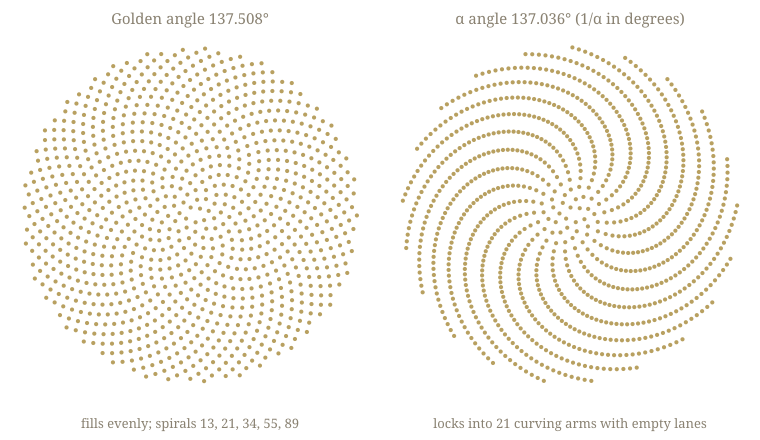

# α as Resonance: Staged Reframing of the α Page

**Staged for countersign; not canon.** Claude drafted this on 2026-10-22 at Ashman's direction, given in that day's session: *"maybe we don't need a derivation, resonance might be enough,"* then *"Draft the resonance reframing of the α page as a staged proposal for my countersign: say what is observed, what is a reading, and what would count against it. Don't touch canon until I sign."* Until Ashman countersigns, nothing in `CLAUDE.md`, `circumpunct_framework.md`, the root files, or `docs/` changes. `docs/alpha_derivation.html` stays at v1.1 (the prior-art revision made earlier the same day at Ashman's request; it is the starting point for this proposal). Every number below is reproduced by `experiments/alpha_resonance_numbers_v1.py`, which also writes the figure `plans/alpha_resonance_phyllotaxis_2026_10_22.svg`.

---

## 0. The proposal in one paragraph

The α closed form moves from **derivation** to **resonance**. A derivation claims the formula is forced: every symbol pinned by axioms, the third term unique, the match a compression of nine significant figures into zero free parameters. A resonance claims less and keeps more. It says three things: the measured value of 1/α sits, at three successively finer levels, on expressions built from φ and small integers, beginning with the golden angle; the framework offers readings of why those expressions; and the claim states in advance what would show the match to be chance. The representation layer is untouched: α stays measured input to κ₀,₀. No other constant moves, because every cross-validation formula (G, Λ, the mass ratios, the Weinberg angle, Cabibbo, the Higgs quartic) already takes α as input and never uses the closed form.

## 1. Why now

Three findings from 2026-10-22, all now cited in `alpha_derivation.html` v1.1:

1. **The base is prior art.** Heyrovska and Narayan (2005, arXiv:physics/0509207) observed that α ≈ φ²/360 = 1/137.508 and that the gap 0.472 equals 2/φ³. That is 360/φ² − 2/φ³ in all but notation.
2. **A rival third term fits better.** Pellis (2021, "Exact expressions of the fine-structure constant") closes the same remainder with +(3φ)⁻⁵ at −0.09 ppb, against our +3α/59 at −0.22 ppb. His term can be written in pool integers as (Tφ)^−(Φ+○).
3. **The leading term means "golden angle" only in degrees.** In radians the golden angle is 2.39996; the match to 137.5 depends on dividing a turn into 360.

Under the derivation framing, finding 2 engages the page's falsification criterion 3 ("a nearby alternative with equal or better numerical fit"). It arguably also engages §27.7a's own falsifiers (1) ("any framework integer can be replaced with another framework integer and improve the fit") and (3) ("the 59/3 denominator is degenerate with some other framework ratio at sub-ppb precision"). Under the resonance framing it kills nothing: it is a second resonance at the same remainder.

The reframe also costs nothing structurally. The derivation was always an auxiliary-claim layer stacked on a representation layer that takes α as input. The corpus has already retracted it once and restored it (the framework header's revision block and the §27.7a restoration notice). This proposal is a third position: keep the formula, change the claim.

## 2. What is observed

*Observed* means: a number anyone can check, with no framework interpretation attached.

**O1. The anchor is the golden angle, and it is not the best fit of its form.** 360/φ² = 137.507764 sits 0.344% above 1/α = 137.035999177 (CODATA 2022). The integer n that makes n/φ² closest to 1/α is 359, not 360: 359/φ² = 137.1258, five times closer (0.066%). The leading term earns its place by what it means, not by how well it fits. A constant drawn uniformly from 100 to 200 lands within 0.344% of 137.508 about 1 time in 100. That count ignores how many other meaningful numbers (4π³ + 13, Eddington's 137, Wyler's 1969 formula, and many since) would also have been accepted as anchors. In phyllotaxis the divergence angle is conventionally written α; the Math Files video writes θₙ = nα and α ≈ 137.507764°. The shared letter is a convention, not a link, though it may be part of why the two numbers keep getting paired.

**O2. The first correction is a modest coincidence within its family.** The gap 360/φ² − 1/α = 0.4717649 matches 2/φ³ = 0.4721360 to 0.079%. In the family b·φ^k (b = 1..12, k = −6..6; 156 forms), 2/φ³ is the only hit at that precision. Matched null: for a target drawn uniformly from 130 to 137.4, with the same anchor, family and relative tolerance, some form hits 3.8% of the time (about 1 in 26). This stage is Heyrovska and Narayan's.

**O3. The last remainder has two known closures, at the measurement floor.** After the base, 0.000371082 remains.

| Third term | Its value | Predicted 1/α | vs CODATA 2022 |
|---|---|---|---|
| none (2005 base) | 0 | 137.035628095 | −2.7 ppm |
| +3α/59 (ours; self-referential) | 0.000371052 | 137.035999147 | −0.22 ppb (1.4σ) |
| +(3φ)⁻⁵ (Pellis 2021; fixed number) | 0.000371070 | 137.035999165 | −0.09 ppb (0.6σ) |

CODATA's uncertainty is 5.7 × 10⁻⁵ of this remainder, so stage 3 lives at the edge of what measurement resolves.

- In the family α·p/q, 3/59 is the only hit with q ≤ 200. The expected number of chance hits, by local density, is 0.027 for q ≤ 100 and 0.11 for q ≤ 200.
- In the family c·(aφ)⁻ᵏ (c, a = 1..6, k = 1..8; 288 forms), (3φ)⁻⁵ is the only hit, with about 0.003 expected by chance.

**O4. The direct measurements disagree with each other by more than the closures do.** The two best direct determinations are Cs recoil (Berkeley, 2018), 137.035999046(27), and Rb recoil (LKB Paris, 2020), 137.035999206(11). They differ by 1.17 ppb, which is 5.5σ combined. Our closure and Pellis's differ by 0.13 ppb, about nine times less. Each closure is more than 3σ from each measurement taken alone:

- ours: +0.74 ppb vs Cs, −0.43 ppb vs Rb
- Pellis: +0.87 ppb vs Cs, −0.30 ppb vs Rb

Both closures sit between the two experiments, where CODATA's combined value sits. On present data, neither closure can be preferred over the other.

**O5. Digit accounting.** Stage 1 supplies 2.5 digits of 1/α, stage 2 supplies 3.1 more, and stage 3 supplies 4.1 more, for 9.7 in total. Each stage is one term chosen from a family. Had the three families been declared before looking, the per-stage chance rates (about 1/100, 1/26 and 1/40 to 1/350) would multiply to roughly 1 in 100,000. They were not declared, by us or by Pellis, and α numerology is a large literature, so the overall significance cannot be scored. What can be said is narrower: within any one small family, each stage's hit is unlikely by chance; across the unknown number of families searched by many people, two independent third-term hits are not surprising. This replaces the §27.7a "five-order-of-magnitude compression" argument, which counted tuning parameters but not the choice of family.

**O6. As a divergence angle, 137.036° locks; the golden angle does not.** Treat each angle as the turn between successive seeds in a sunflower (the Vogel model) and expand the fraction of a turn as a continued fraction:

- Golden: 0.3819660 = [0; 2, 1, 1, 1, 1, 1, 1, ...], so the spiral counts run 2, 3, 5, 8, 13, 21, 34, 55, 89 and never lock.
- α angle: 0.3806556 = [0; 2, 1, 1, 1, 2, 7, 3, 1, 6], so the spiral counts run 2, 3, 5, 8, then skip 13 to 21.

The partial quotient 7 makes 8/21 an unusually close approximation. Seeds therefore organize into 21 curving arms with empty lanes between them, each arm turning 2.24° per step outward, and the structure holds across the whole 1,000-seed head (figure). The next convergent is 59/155. A shift of 0.47° from the golden angle turns an even fill into channels. This is the line that started the thread, "a fraction of a degree can change an entire pattern," made exact.

An independent visualization makes the same point: the Math Files post on X (2026-10-21) that started this thread, a 38-second clip stepped through frame by frame on 2026-10-22. It shows 137° and 137.1° locking into arms, while 137.5° and 137.507764° fill evenly. Both of its locked examples share 1/α's continued-fraction head [0; 2, 1, 1, 1, 2, ...]. So they belong to the same 21-arm family, centered on the exact 21-spoke angle 360·8/21 = 137.1429°. Measured as an angle, 1/α is 0.107° from that spoke angle and 0.472° from the golden angle. A sunflower at 1/α degrees is a 21-arm head, not a slightly imperfect golden one.

**O7. α runs.** 1/α ≈ 137.036 is the low-energy (Thomson-limit) value; at the Z mass it is about 128. Every resonance above attaches to the low-energy value only.

## 3. What is a reading

*Reading* means: an interpretation the framework offers for an observation. It is graded, may be wrong, and is never cited as evidence for itself.

**R1. Closure is the lock (candidate; new).** The golden angle is the angle at which new centers keep arriving without locking onto the old ones: an even fill, no channels. The correction −2/φ³ is the term the station reading already calls closure (3D, A4). In O6, that same correction is exactly what turns the even fill into 21 channels. Reading: *the golden angle is the open field; α is the field after closure; the correction is the price of having a boundary.* This inverts the reading proposed in the 2026-10-22 conversation ("α as the non-locking coupling"). O6 counts against that strong form, because the α angle locks. Only this weaker, closure form survives. It makes no prediction yet, so it stays a reading. *Caveat added after the video (2026-10-22):* locking is generic. Nearly any angle off the golden one locks into some arm count (golden + 1° locks into 13 arms), so "the correction produces a lock" would be true of almost any correction. R1's content reduces to the size and direction of the offset: −0.47°, into the 21-arm band. It is weaker than first drafted and should not be promoted without C5.

**R2. 360 as P!·T·(Φ+○) = 24·3·5 (reading; retained).** Under resonance the unit question stops being fatal, because nothing is derived from it, but it does not disappear. The resonance is between 1/α measured in degrees and the golden section of a turn, so it depends on the turn having 360 parts. The integer factorization is the reading that would make the 360 non-arbitrary. If it fails, the anchor is a coincidence of the Babylonian degree.

**R3. The three station terms (reading; demoted from "axiom-forced").** These are kept as an interpretation, not a derivation: 2D mediator (360/φ²), 3D closure (−Φ/φ³), and 0D self-return (+α/(59/3), the aperture reading itself once). This reading carries the pending re-derivation under the corrected ladder (2D is now ○, not Φ; the photon-as-2D-mediator language is on the 2026-06-09 list).

**R4. Both closures have pool readings (reading; no preference).** 59/3 = (P·V+R)/T = (S−Φ−T)/T (Route 7). (3φ)⁻⁵ = (Tφ)^−(Φ+○), whose type under the octave-wrap rule is unchecked. Our closure is self-referential (α in its own expression); Pellis's is a fixed number. The framework need not choose between them; measurement will (C3).

**R5. Noticed, not claimed (density caveat).** The α angle's arm count 21 is A(3), the G exponent. Its next convergent's numerator, 59, is the 59 of 59/3. Both are small integers in a dense pool, and 21 is also a Fibonacci number (the golden angle passes through 8/21 too). They are listed only so a future session does not rediscover them as findings. Do not build on them. The video's 137° and 137.1° heads show the same 21 arms, so the arm count belongs to the whole band around 137.14°, not to α.

## 4. What would count against it

A resonance without its own discipline is numerology that cannot fail. Each item below is stated before it is needed.

**C1. The matched null (the only test of stages 1 and 2).** No achievable measurement can falsify stages 1 and 2: they sit 2.7 ppm away, far outside every experiment's error bars. Only statistics can. The families used in O2 and O3 are now declared in the script. Any future anchor or closure must come from a family declared before it is evaluated, with the family size and the matched-null rate reported alongside it. The bar is the corpus's own: a hit must beat a matched-magnitude null by about 3× (the §27.7n discovery-tool caveat). If a declared, matched null does not clear that bar, the resonance is withdrawn as a claim and kept as dated history. Stage 2 currently sits at 3.8% under its null. What counts as a clear pass for a single constant is itself something to adjudicate.

**C2. Scale.** α runs (O7). If the framework cannot say *why* the low-energy value is the one that resonates, the resonance is an artifact of the scale at which we happen to measure. Candidate answer, stated now so it is not invented later: q² → 0 is the electron's own scale, |•_electron| at rest, where κ₀,₀ is defined. If the framework's own reading of κ₀,₀ attaches α to a different scale, the resonance fails.

**C3. Measurement decides stage 3.** The Cs/Rb disagreement (O4) is the live test. If the resolved value lands outside both closures (for example, Rb 2020 holding at its current uncertainty, more than 3σ from each), stage 3 fails for both. The resonance then retreats to stages 1 and 2, credited to Heyrovska and Narayan, with the framework's readings. If it lands on one closure and excludes the other, that closure is preferred, and its reading (self-reference or fixed constant) gains weight.

**C4. Downgrade rule.** If one more declared family yields a third closure as good as these two, stage 3 carries no information about which structure is right. It is then recorded as "the remainder is fillable," nothing more.

**C5. R1 must earn a prediction.** "Closure is the lock" stays a reading until it predicts something not used to build it. For example, it might say which other ladder constants should, read as angles, lock and which should not. A prediction that fails withdraws it.

## 5. What changes and what does not

| Item | Under this proposal |
|---|---|
| α as measured input to κ₀,₀ (representation layer) | unchanged |
| G, Λ, mass ratios, Weinberg, Cabibbo, Higgs quartic | unchanged (all take α as input) |
| Interim glyph-integer rule, octave-wrap lemma, Routes 6 and 7 | unchanged |
| The closed form 360/φ² − 2/φ³ + 3α/59 | kept, as one of two known closures |
| "Forced," "unique," "no residuals," "zero free parameters at the factor level" | retired |
| "Five-order-of-magnitude compression" (§27.7a) | retired; replaced by the O5 digit accounting |
| The page's falsification criteria 1-5 and §27.7a's falsifiers 1-5 | replaced by C1-C5 |
| Cross-validation (§6 of the page) | kept, re-read as evidence that the integer pool is coherent, not as evidence for the α formula (those formulas take α as input) |
| Derivation, retraction and restoration history | kept as dated record; no silent retraction |

## 6. Proposed page (applies only on countersign)

- **File:** keep `docs/alpha_derivation.html` (inbound links), version 2.0.
- **Title:** "α and the Golden Angle: A Resonance".
- **Subtitle:** "The measured value of 1/α sits on the golden angle and two small corrections in φ. This page says what is observed, what the framework reads into it, and what would show it to be chance. α itself stays measured input to κ₀,₀."
- **Sections:**
  1. What α is in the framework (unchanged two-layer text, shortened).
  2. Observed (O1-O7, the stage table, the measurements table, the figure).
  3. Readings (R1-R4, graded; R5 as a footnote).
  4. What would count against it (C1-C5).
  5. Prior art (Heyrovska and Narayan 2005; Pellis 2021; the wider α-numerology literature named in one line).
  6. History (derivation 2026-04, retraction, restoration, resonance), with the v1.1 derivation text preserved under a collapsed "Derivation-era text (superseded 2026-10-xx)" block, or moved to `docs/alpha_derivation_v1.html` (decision 3).
- **Opening paragraph (draft):** *For a century people have noticed that 1/α ≈ 137 sits close to numbers that mean something. The closest one with a meaning outside physics is the golden angle, 137.508°, the turn between successive seeds in a sunflower. Two small corrections in φ bring it to the measured value: the first to 2.7 ppm, the second to the edge of what experiments can resolve. This page does not claim that the corrections are forced. It claims that the match is there, says what the framework reads in it, and says in advance what would show it to be chance.*

## 7. Migration list (applies only on countersign)

From a sweep for "0.22 ppb" and "137.035999147" on 2026-10-22:

- **`CLAUDE.md` (4 sites):**
  - the auxiliary-claim sentences in the "α is |•_electron|" paragraph
  - the Structural Grammar α bullet
  - the Key Files rows for `docs/the_unit_equation.html` ("releases α (0.22 ppb)")
  - the Key Files row for `docs/alpha_derivation.html`
- **`circumpunct_framework.md`:**
  - the 2026 revision header (around line 85)
  - §15.5.1 (around lines 11943-12062, including the "ZERO FREE PARAMETERS" box)
  - the §27.7 rung table (around line 20082)
  - Rung 0D (around lines 20115-20133)
  - the §27.7a restoration notice and derivation (around lines 20173-20292)
  - the table at around line 20317
  - Uniqueness (around line 20423)
  - Information-theoretic compression (around line 20431)
  - the falsifiers (around line 20437)
  - the joint-precision ε line (around line 20893)
- **Root files:** `Circumpunct_ToE.md` (11 hits), `circumpunct_treemap.md` (6), `circumpunct_predictions.md` (4), `README.md` (3), `EXECUTIVE_ABSTRACT.md` (1).
- **Published pages (22):**
  - `alpha_derivation`, `512-state_circumpunct_particle_table`, `biology_predictions`, `circumpunct_IT_v2`
  - `circumpunct_framework`, `circumpunct_operators`, `circumpunct_physics`, `circumpunct_predictions`
  - `circumpunct_seed`, `circumpunct_treemap`, `dimensional_ladder`, `e_equals_1`
  - `gravity`, `index_older`, `machine_language`, `mass_ratios`
  - `predictions_dashboard`, `predictions_history`, `shut_up_and_calculate`, `ten_dimensions_expanded`
  - `the_unit_equation`, `toe_map`

Most of these sites state the number, not the derivation claim. Where only the number appears, the fix is a word ("closed form" becomes "resonance"). Where "derived," "forced" or "zero free parameters" appears, the sentence is rewritten.

## 8. Open decisions (Ashman to adjudicate)

1. **The reframe itself.** Countersign derivation → resonance, with C1-C5 as the claim's discipline.
2. **What goes in the headline.**
   - (a) Ours, with Pellis as a rival (the v1.1 status quo).
   - (b) Both closures as co-equal resonances.
   - (c) The two-stage resonance (golden angle + 2/φ³, 2.7 ppm, credited to Heyrovska and Narayan, carrying the framework's readings) as the headline, with stage 3 presented as open between two known closures until the Cs/Rb disagreement resolves.

   **Recommended: (c)**, because O4 shows present data cannot prefer either closure. The cost: the framework's own contribution (59/3 and its self-reference) becomes one of two candidates rather than the answer.
3. **Old text.** Preserve the derivation-era text in a collapsed block on the page, or move it to `docs/alpha_derivation_v1.html`.
4. **R1 (closure is the lock).** Promote it to the page as a graded reading, or keep it in this record until it earns a prediction (C5).
5. **C1 timing.** Run the full matched null across declared families before countersign, or after.

---

**Countersign:** ____________________ (Ashman) Date: __________
